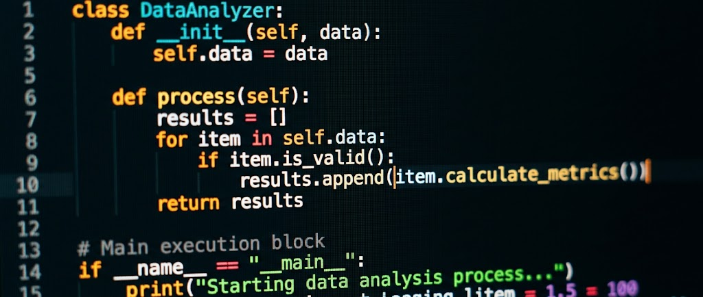

# `> Olá, eu sou [SEU NOME]`

### `Desenvolvedor em formação | Tech enthusiast`

`Transformando ideias em código.`

---

## `01 // ABOUT ME`

> Um pouco sobre quem sou e o que estou construindo.

- **Nome:** 
- **Localização:** 
- **Formação:** 
- **Área de interesse:** 
- **Sobre mim:** 
- **Meu objetivo na programação:** 

## `02 // MY CHARACTERISTICS`

- **Pontos fortes:** 
- **Habilidades pessoais:** 
- **Como gosto de aprender:** 
- **O que me motiva:** 
- **Meus interesses:** 

## `03 // TECH STACK`

### Linguagens de programação
<!-- Coloque aqui as linguagens que conhece ou está aprendendo -->

- 

### Frameworks e bibliotecas
<!-- Ex.: React, Express, .NET -->

- 

### Ferramentas e tecnologias
<!-- Ex.: Git, GitHub, VS Code, MySQL -->

- 

## `04 // CURRENTLY LEARNING`

- [ ] 
- [ ] 
- [ ] 

## `05 // PROJECTS`

### `PROJECT_01`

- **Nome:** 
- **Descrição:** 
- **Tecnologias utilizadas:** 
- **O que aprendi:** 
- **Repositório:** 

### `PROJECT_02`

- **Nome:** 
- **Descrição:** 
- **Tecnologias utilizadas:** 
- **O que aprendi:** 
- **Repositório:** 

### `PROJECT_03`

- **Nome:** 
- **Descrição:** 
- **Tecnologias utilizadas:** 
- **O que aprendi:** 
- **Repositório:** 

## `06 // FUTURE BUILDS`

| Projeto | Ideia | Status |
|---|---|---|
| Projeto 01 |  | Planejamento |
| Projeto 02 |  | Ideia |
| Projeto 03 |  | Ideia |

## `07 // GOALS`

- [ ] 
- [ ] 
- [ ] 

## `08 // GITHUB STATS`

## `09 // CONTACT`

- **E-mail:** 
- **LinkedIn:** 
- **Portfólio:** 

---

`> SYSTEM STATUS: ALWAYS LEARNING_`

